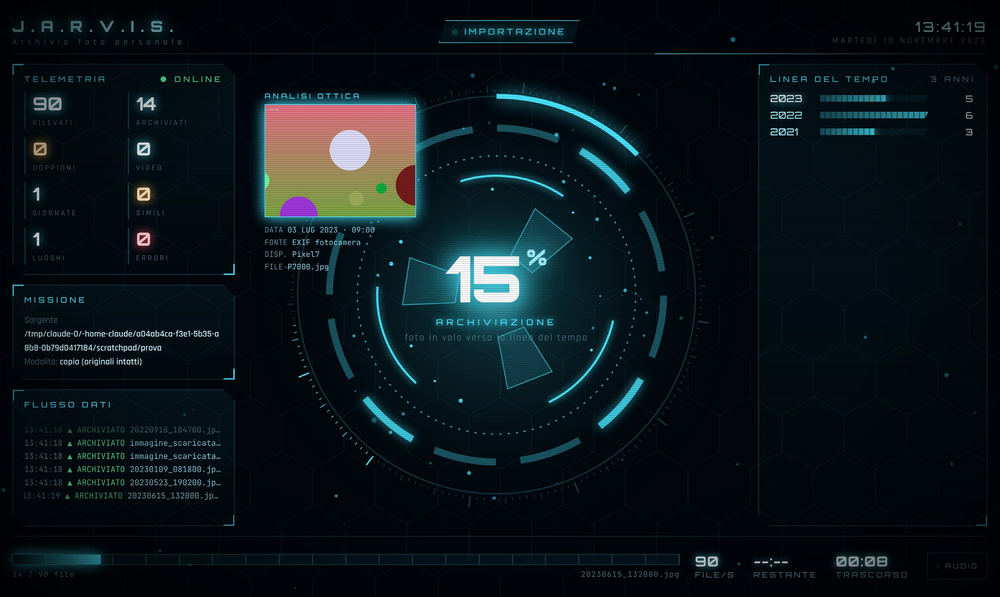

<p align="center"></p>

<h1 align="center">J.A.R.V.I.S. Foto</h1>
<p align="center"><b>Il tuo archivista personale di foto e video.</b><br>
Importa da cartelle, zip e supporti · ordina per data vera · scarta i doppioni · backup zippato su disco esterno · pannello olografico in tempo reale.<br>
Funziona tutto sul tuo PC, da solo: le foto non vanno mai su internet.</p>

<p align="center"></p>

---

## Cosa fa

Gli dici *"Jarvis, prendi le foto dalla chiavetta e sistemale"* e lui:

1. **Esplora** la sorgente: cartella, file `.zip` (anche zip dentro zip), chiavetta, scheda SD, hard disk, oppure la **cartella Arrivi**.
2. **Legge la data vera** di ogni file: EXIF della fotocamera → metadati video (con correzione dell'ora dei video Android) → file `.json` di Google Takeout → data nel nome (WhatsApp, screenshot, Pixel…) → data del file come ultima risorsa (segnalata nel registro).
3. **Riconosce i doppioni** con un'impronta digitale (SHA-256): anche se hanno nomi diversi, la stessa foto entra una volta sola.
4. **Riconosce le foto quasi uguali** (copie ridotte da WhatsApp, raffiche) con un'impronta visiva: nella linea del tempo resta la migliore, le altre vanno in `Da scegliere`.
5. **Capisce dove sei stato**: dal GPS ricava il comune (o la città all'estero) senza internet e lo usa per dare il nome alle giornate.
6. **Rinomina e archivia** in una struttura pulita; le **Live Photo** dell'iPhone restano unite (foto + video con lo stesso nome).
7. **Fa il backup** su hard disk esterno: zippato, incrementale, verificato. Se è passato troppo tempo te lo ricorda.
8. **Ti chiede** se importare quando inserisci una scheda o una chiavetta, e se aggiornare il backup quando colleghi il disco.
9. **Ti mostra tutto** su un pannello in stile Iron Man, con le foto che volano nella linea del tempo, e ti parla in italiano.

## Come organizza l'archivio

```
JARVIS_Foto/
├── Foto/
│   └── 2025/
│       ├── 07 Luglio/
│       │   └── 2025-07-03_09-00-00_Pixel7.jpg
│       └── 08 Agosto/
│           ├── 2025-08-02_18-44-10_iPhone15Pro.jpg
│           └── 2025-08-14 Giovedì - Ponza/   ← giornata con tante foto, col luogo dal GPS
│               ├── 2025-08-14_16-00-20_iPhone15Pro.jpg
│               └── …
├── Arrivi/                    ← butta qui foto, cartelle, zip: JARVIS le smista e svuota la cartella
├── Video/2025/08 Agosto/2025-08-14_20-03-00.mov
├── Da scegliere/2025-08-14_16-21-48/   ← foto quasi uguali + LEGGIMI.txt (a cosa somigliano)
├── Screenshot/2025/2025-01-02_10-10-11.png
└── _JARVIS/
    ├── indice.json            ← impronte per riconoscere i doppioni
    ├── registro/*.csv         ← per ogni importazione: nome vecchio → nome nuovo (si apre con Excel)
    ├── Doppioni/              ← solo in modalità "sposta": i doppioni messi da parte, mai cancellati
    ├── Annullati/             ← le copie tolte con "annulla l'ultima importazione"
    └── Zip_importati/         ← gli zip già elaborati dalla cartella Arrivi
```

Perché così:
- **Anno → mese** in ordine cronologico, con il nome del mese in italiano, e nomi file che si ordinano da soli.
- **Giornate speciali**: se in un giorno ci sono almeno 12 foto (feste, viaggi, eventi) JARVIS crea una cartella dedicata. Puoi darle un nome ("Compleanno Angelica", "Raccolta AVIS") e le importazioni future di quel giorno finiranno lì.
- **Dispositivo nel nome** (`iPhone15Pro`, `SamsungS918B`, `WhatsApp`): sai subito da dove arriva ogni foto.
- **Video e screenshot separati**, così l'album delle foto resta pulito.

## La cartella Arrivi (il modo più semplice)

Il telefono collegato col cavo USB **non** compare come unità (E:, F:…), quindi il modo più semplice è:
1. apri il telefono da Esplora file e copia la cartella `DCIM` (o le foto che vuoi) nella cartella **JARVIS Arrivi** (icona sul desktop);
2. quando la copia è finita JARVIS ti chiede *"Nella cartella Arrivi ci sono N nuovi file. Li sistemo?"*. Rispondi **Sì**. In alternativa usa il menu *JARVIS Foto* → 7.

Vale anche per gli zip di Google Foto (Takeout), le foto ricevute, le cartelle vecchie. Alla fine Arrivi è di nuovo vuota.

## Quando inserisci una scheda o una chiavetta

La sentinella parte da sola con Windows. Quando inserisci un supporto se ne accorge, conta le foto e **ti chiede con una finestra**:
> *Ho trovato 230 foto e video su E: (CANON). Vuoi importarli nell'archivio?*

Solo se rispondi **Sì** le copia nella cartella Arrivi (gli originali restano sulla scheda) e le mette in ordine. Se colleghi il **disco del backup** e serve aggiornarlo, chiede anche quello. Si disattiva mettendo `"sorveglianza": false` in `jarvis.config.json`. C'è sempre una sola sentinella attiva, anche se usi l'estensione per Claude Desktop.

## Sicurezza prima di tutto

- **Modalità copia (predefinita)**: gli originali restano dove sono, intatti.
- **Modalità sposta**: cancella dalla sorgente solo *dopo* aver verificato l'impronta della copia. I doppioni vanno in `_JARVIS/Doppioni`.
- **Non cancella mai nulla** dall'archivio né dal backup.
- **Ogni file copiato è controllato**; i file danneggiati o rinominati per sbaglio vengono scartati e segnalati.
- **Registro CSV** di ogni importazione, e **annulla** dell'ultima importazione (le copie vanno in `_JARVIS/Annullati`, i file spostati tornano dov'erano).

## Il backup

```
F:\JARVIS_Backup\
├── 2025\JARVIS_Foto_2025-07.zip
├── 2025\JARVIS_Foto_2025-08.zip
├── JARVIS_Foto_Registro.zip
└── backup_jarvis.json
```
- **Uno zip per mese**: al backup successivo riscrive solo i mesi cambiati, quindi ci mette pochi secondi.
- **Zip "store"**: le foto sono già compresse, così il backup è molto più veloce e gli zip si aprono con Windows senza programmi aggiuntivi.
- **Ogni zip viene verificato** prima di sostituire il precedente. Se un mese supera 3,8 GB lo divide in parti, così funziona anche su chiavette formattate FAT32.
- **Verifica profonda**: ricalcola l'impronta di ogni foto dentro gli zip e la confronta con l'archivio.

---

## Installazione su Windows (autonoma)

JARVIS gira da solo sul PC: parte con Windows, resta in ascolto e non ha bisogno né di Claude né di internet.

**Un solo comando**: apri *Windows PowerShell* e incolla

```powershell
irm https://raw.githubusercontent.com/antonioflamini/jarvis-foto/main/installa.ps1 | iex
```

L'installatore:
1. scarica dalla pagina [Releases](../../releases) il pacchetto `JARVIS-Foto-Windows.zip`, che ha **Node.js già incluso**, quindi non devi installare nient'altro;
2. lo mette in `%LOCALAPPDATA%\JARVIS-Foto`;
3. ti fa tre domande: nome, cartella dell'archivio, disco del backup;
4. crea le icone **JARVIS Foto**, **JARVIS Arrivi** e **JARVIS Pannello** sul desktop e nel menu Start;
5. fa partire la **sentinella** a ogni accensione, senza finestre.

In alternativa (anche con repository privato) scarica `JARVIS-Foto-Windows.zip` dalla Release, estrailo e fai doppio clic su `installa.bat`.

Guida completa passo passo, dalla creazione del repository alle prove: **[docs/INSTALLAZIONE.md](docs/INSTALLAZIONE.md)**.
Per farti guidare da Claude Desktop c'è un testo pronto da incollare: **[docs/GUIDA_PER_CLAUDE.md](docs/GUIDA_PER_CLAUDE.md)**.

- **Aggiornare**: menu Start → *JARVIS Foto* → **Aggiorna JARVIS** (scarica l'ultima Release; impostazioni e foto restano).
- **Disinstallare**: menu Start → *JARVIS Foto* → **Disinstalla JARVIS** (archivio e backup non vengono toccati).

## Uso di tutti i giorni

- **Scheda SD o chiavetta**: la inserisci, JARVIS chiede *"Vuoi importarle?"*, rispondi Sì.
- **Telefono, zip, Google Foto**: copi tutto nella cartella **JARVIS Arrivi**, JARVIS chiede *"Li sistemo?"*, rispondi Sì.
- **Backup**: colleghi il disco esterno; se serve aggiornarlo, JARVIS te lo chiede.
- **Menu `JARVIS Foto`** (icona sul desktop):

| Tasto | Azione |
|---|---|
| 1 / 2 | importa da un supporto / da una cartella o zip |
| 3 / 4 | backup / verifica profonda del backup |
| 5 / 6 | pannello olografico / stato dell'archivio |
| 7 | sistema subito la cartella Arrivi |
| 8 | annulla l'ultima importazione |
| 9 | riavvia la sentinella |
| D | diagnostica |
| A | aggiorna JARVIS da GitHub |

Trascinando una cartella o uno zip sopra l'icona *JARVIS Foto* l'importazione parte subito.
Le impostazioni sono in `%LOCALAPPDATA%\JARVIS-Foto\jarvis.config.json` e il registro della sentinella in `jarvis.log`.

Da riga di comando (`node src/cli.js …`): `importa <sorgente> [--sposta]` · `anteprima <sorgente>` · `backup [F:\] [--completo]` · `verifica [F:\] [--profonda]` · `arrivi` · `annulla` · `simili` · `sorveglia` · `diagnostica` · `supporti` · `stato` · `pannello`.

## Facoltativo: estensione per Claude Desktop

Se un giorno vuoi anche parlare con JARVIS da Claude Desktop, ogni Release contiene `jarvis-foto.mcpb`:
doppio clic → Installa. Le due cose convivono: la sentinella resta una sola.

| Frase a Claude | Cosa succede |
|---|---|
| *Jarvis, che supporti ho collegati?* | elenca chiavette, schede, dischi; segnala quelli con foto (DCIM) |
| *Fammi vedere cosa importeresti da E:* | anteprima senza toccare nulla |
| *Importa le foto dalla scheda E:* | importazione con pannello olografico |
| *Importa C:\Users\Antonio\Downloads\foto_mare.zip* | legge anche gli zip |
| *Sposta le foto dalla chiavetta nell'archivio* | modalità sposta (con verifica) |
| *Sistema gli arrivi* | smista la cartella Arrivi |
| *Il 14 agosto 2025 chiamalo "Ferragosto al mare"* | dà il nome alla giornata |
| *Annulla l'ultima importazione* | rimette tutto com'era |
| *Ci sono foto doppie da scegliere?* | elenca i gruppi in "Da scegliere" |
| *Qualcosa non va, fai un controllo* | diagnostica dell'installazione |
| *Fai il backup sul disco F:* | backup incrementale e verificato |
| *Controlla bene il backup* | verifica profonda |
| *A che punto sei?* / *Com'è messo l'archivio?* | stato e avanzamento |
| *Apri il pannello* | statistiche dell'archivio sul pannello |


## Come è fatto (gli agenti)

| Agente | File | Compito |
|---|---|---|
| **Esploratore** | `src/agenti/esploratore.js` | trova foto/video in cartelle, zip, supporti; rileva le unità collegate |
| **Archivista** | `src/agenti/archivista.js` | data vera, doppioni, giornate speciali, nomi, copia verificata, registro |
| **Custode** | `src/agenti/custode.js` | backup zip mensile incrementale, divisione in parti, verifica |
| **Regista** | `src/agenti/regista.js` + `src/hud/index.html` | pannello olografico locale (`127.0.0.1`) e voce |
| **Sentinella** | `src/agenti/sentinella.js` | si accorge di schede/chiavette/disco del backup e chiede cosa fare |
| Simili | `src/agenti/simili.js` | impronta visiva (dHash) per le foto quasi uguali |
| Luoghi | `src/agenti/luoghi.js` + `src/dati/` | comune o città dalle coordinate GPS, senza internet |
| **Cervello** | `src/jarvis.js` | coordina gli agenti, un lavoro alla volta |
| Installatore | `installa.ps1` (avvio nascosto con `node src/cli.js sfondo sorveglia`) | installazione da GitHub, icone, avvio automatico |
| Ponte con Claude (facoltativo) | `src/server.js` | server MCP con 13 strumenti |

Formati: JPG, PNG, HEIC/HEIF (iPhone), WebP, GIF, TIFF, BMP, AVIF, RAW (DNG, CR2, CR3, NEF, ARW, RAF, ORF, RW2…), video MP4, MOV, M4V, 3GP, AVI, MKV, MTS, WMV, WebM.

## Sviluppo

```
npm install
npm test                       # 28 prove automatiche, in una cartella temporanea
npx @anthropic-ai/mcpb pack    # crea il pacchetto jarvis-foto.mcpb
```
Ogni Release pubblicata su GitHub crea automaticamente `JARVIS-Foto-Windows.zip` (con Node.js portatile) e `jarvis-foto.mcpb` (vedi `.github/workflows`).

## Licenza e crediti

MIT © Antonio Flamini

- Comuni italiani con coordinate: pacchetto [italian-cap-comuni-province](https://www.npmjs.com/package/italian-cap-comuni-province) (MIT), dati ISTAT.
- Città del mondo: [all-the-cities](https://www.npmjs.com/package/all-the-cities) (MIT), dati [GeoNames](https://www.geonames.org) (CC BY 4.0).
- Caratteri Orbitron, Rajdhani, JetBrains Mono: SIL Open Font License (via Fontsource).
